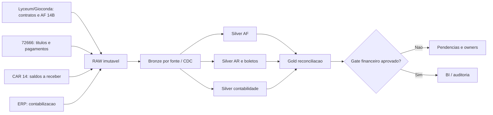

# Definitiva — integração de Crédito CREDIN (AF/AR/ERP)

**Domínios independentes:** (a) compromisso/bolsa/AF e regra de geração de dívida, (b) título/boletos 72666 e emissão, (c) AR (posição do relatório 14), (d) contabilidade/ERP e movimentos de baixa. Os relacionamentos devem ser por chave oficial e competência, **não por nome do aluno nem por soma global**.

**Arquitetura proposta:**



**Implementado no laboratório:** normalização de boletos, domínios sintéticos AF/AR/ERP separados, chaves exclusivas por domínio, comparação por RA e divergências por linha, pendências e gate BI bloqueado em cenários intencionalmente inconsistentes. O valor AF é exibido mas **não comparado como se fosse saldo AR**.

**A implantar apenas depois:** Delta/Databricks, taxonomia definitiva de CREDIN CP/LP EAD/PRES/MED, chaves e vínculos `bolsa → dívida → título → pagamento → razão`, contabilização de renegociação, histórico de alunos/cancelamentos, crédito a gerar, PDD, tolerâncias contábeis e aceite do owner.

## Executar separadamente

```powershell
cd .\solucao_definitiva
.\executar.ps1
```

**Código-fonte modular:** `../src/dor11/credin.py` (motor e regras); `../src/dor11/io_utils.py` (integridade e contratos); `executar.py` (entrada de execução independente).
